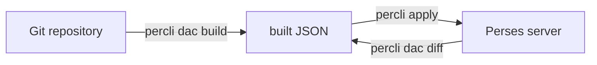

# Dashboards As Code

Most dashboards start in a browser. Someone adds a panel, changes a query, saves, and moves on. That works until the dashboard breaks, and nobody can say what changed, who changed it, or what it looked like before. This part explains how Dashboard-as-Code (DaC) answers those questions, and which of the two ways Perses offers to write dashboards fits which team.

## A dashboard is already data

Before you change how dashboards are made, look at what Perses stores. Perses keeps every dashboard as a resource: a JSON object with a `kind`, a `metadata` block and a `spec`. The `spec` holds the panels, the layouts that place them on the page, the queries each panel runs, and the variables. The Perses user interface is one way to edit that JSON. A text file is another.

The playground already holds one dashboard, `prometheus-storage`. To look at it, you need a way to run `percli`, the Perses command-line tool. In this course, `percli` runs inside the `dac-runner` pod, together with the `cue` and `go` tools it calls. Define this helper once in each terminal; it runs a command in the pod, in an up-to-date copy of the repository:

<!-- astrona:playground:renew -->

```sh
dac() { kubectl -n dac exec -i deploy/dac-runner -- dac-run "$@"; }
dac percli get dashboards
```

The list shows `prometheus-storage` in the project `inventory`, the project the helper selects for you. Now print the whole resource as JSON:

```sh
dac percli describe dashboard prometheus-storage -ojson
```

The output is one JSON object. Under `spec.panels` you see two panels with keys `0_0` and `0_1`, each with a `plugin` (`TimeSeriesChart`) and a `queries` list holding a PromQL expression. Under `spec.layouts` you see one grid layout titled `Storage` that places both panels. This is the object you will produce from code.

## What changes when the dashboard lives in Git

Dashboard-as-Code keeps the source of that object in a Git repository and treats the server as a copy. A change becomes a commit: it has an author, a message and a diff, and it can go through review before it reaches the server. If the new version is wrong, the previous commit still builds the previous dashboard.

Code also removes repetition. Many dashboards share the same panels: the same "targets up" stat, the same latency graph per service. In JSON you copy them, and the copies drift apart. In code you write the panel once and use it in every dashboard. When the query changes, every dashboard gets the change at the next build.



The diagram shows the DaC loop: Git holds the source, `percli dac build` writes the dashboard JSON into a folder called `built`, `percli apply` sends it to the server, and `percli dac diff` compares the server with the built files.

## Two languages: CUE and Go

Perses offers a software development kit (SDK) for two languages. An SDK is a set of libraries that build Perses resources for you, so you write "a time series panel with this query" instead of every JSON field. Both SDKs produce the same JSON. They differ in how you write it.

| | CUE SDK | Go SDK |
| --- | --- | --- |
| What you write | CUE files: configuration with types and constraints | Go programs that call builder functions |
| How a mistake shows up | At build time, as a value that breaks a schema | At compile time, or as an error the builder returns |
| Reuse | Definitions and packages, merged by unification | Functions, loops and packages |
| What `percli dac build` runs | `cue eval <file> --out json --concrete` | `go run <file> --output json` |
| Fits | Teams that think in configuration and want schemas to reject bad values | Teams that already write Go and want loops, tests and their usual tools |

CUE is a configuration language where types and values are the same thing, so the schema for a panel and the panel itself are written the same way. When you combine your panel with the plugin's schema, CUE checks it and fills in what is missing. Go builds the same panel by calling functions, which makes it easy to loop over a list of services and to test the code.

You can see one dashboard written in Go right away. The repository is the source of `prometheus-storage`:

```sh
dac cat dashboards/go/storage/main.go
```

The program calls `dashboard.New("prometheus-storage", ...)`, adds one panel group titled `Storage` with two panels, and ends with `exec.BuildDashboard(builder, buildErr)`. That last call prints the dashboard as JSON, which is what `percli dac build` collects.

You now know what Perses stores, what moving it into Git gives you, and the two ways to write it. The open question is how the repository is organised, and what the build does with it.

## Common pitfalls

> [!WARNING]
> - **Editing a code-managed dashboard in the browser.** The next apply from Git overwrites the change, and nobody can see it was there. Change the code instead.
> - **Treating the two SDKs as two different dashboard formats.** Both produce the same Perses JSON. A repository can hold CUE files and Go programs side by side.
> - **Forgetting the helper in a new terminal.** `dac` is a shell function. Each new terminal needs it defined again.
