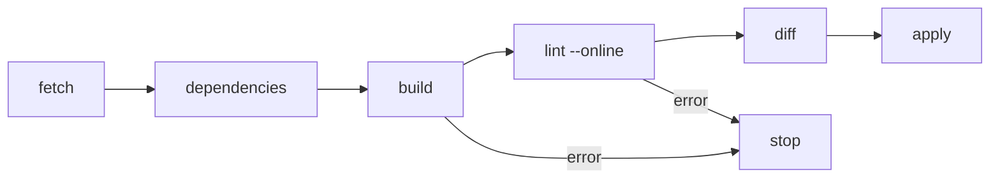

# A Pipeline As A Kubernetes Job

A pipeline is a script that runs the same steps for every commit. Where it runs matters less than how it fails. This part reads the playground's pipeline script, runs it as a Kubernetes Job, and follows the log, so you can see each step and what makes the run stop.

## The script

The pipeline is a shell script in the ConfigMap `dashboards-pipeline` in the namespace `dac`. Print it:

<!-- astrona:playground:renew -->

```sh
kubectl -n dac get configmap dashboards-pipeline -o jsonpath='{.data.pipeline\.sh}'
```

The script runs six steps in order. It clones `main` of `gitops/dashboards` and logs `percli` in to Perses. It downloads the CUE and Go dependencies with `cue mod tidy` and `go mod download`. It builds every dashboard with `percli dac build -d dashboards -ojson`. It lints the results with `percli lint -d built --online`. It runs `percli dac diff -d built`, so the log shows what is about to change. Last, it applies everything with `percli apply -d built`.

The first line after the comments is `set -eu`. `-e` makes the shell stop at the first command that fails, and `-u` makes it stop on an undefined variable. Without `-e`, a failed build would print its errors and the script would go on to apply whatever the build did produce: every dashboard except the broken one. With `-e`, a broken commit applies nothing.



The diagram shows the six steps; with `set -e`, an error in any step, such as the build or the lint, stops the run before the apply.

## The Job

The pipeline runs as a Kubernetes Job. The namespace `dac` holds a CronJob, also called `dashboards-pipeline`, with `suspend: true`, so it never runs on its schedule. It only serves as a template: you start a run by creating a Job from it. Its pod template has the same init container as the runner, which downloads `percli` and `cue`, and runs the script from the ConfigMap in a `golang:1.26.5-alpine` container. `backoffLimit: 0` means a failed run is not retried, so one commit gives one result.

Start a run and wait for it:

```sh
kubectl -n dac create job pipeline-1 --from=cronjob/dashboards-pipeline
kubectl -n dac wait job/pipeline-1 --for=condition=complete --timeout=600s
```

The first run takes a few minutes, because the new pod downloads the tools and the Go and CUE modules. Read the log while it runs, or after:

```sh
kubectl -n dac logs job/pipeline-1
```

The log shows each step's heading, the build report for every file, the lint result, the diff report with a status per dashboard, and the apply report. Every dashboard is new on the server, so the diff reports them as new, and the apply creates them. Check the server:

```sh
dac percli get dashboards
```

The project `inventory` now holds every dashboard of the repository.

## Triggering a run

In this playground you start runs by hand. In a real setup, the Git server starts them: a webhook calls a service that creates the Job, or a CI system such as GitHub Actions runs the same script on every push to `main`. For GitHub Actions, the Perses project publishes ready-made actions that build, lint and apply with `percli`. The steps stay the same; only the trigger changes.

You now know the pipeline's steps, why `set -e` decides whether a broken commit reaches the server, and how to run and read the Job. The open question is what the pipeline cannot do for you once it owns the dashboards.

## Common pitfalls

> [!WARNING]
> - **Hiding a failure with `|| true` or `|| echo`.** The step's error is lost and the run goes on to apply.
> - **Retrying failed runs automatically.** A broken commit fails the same way every time. Keep `backoffLimit: 0` and fix the commit.
> - **Reusing a Job name.** A Job name is unique in its namespace. Delete the old Job or pick a new name for each run.
